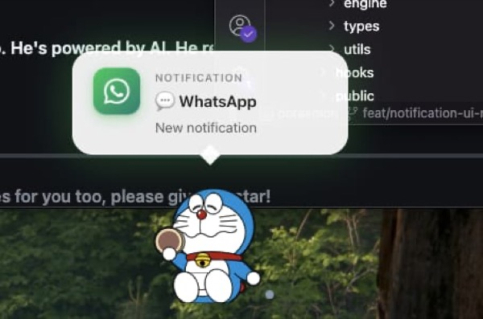
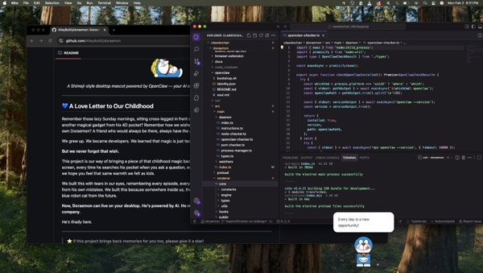
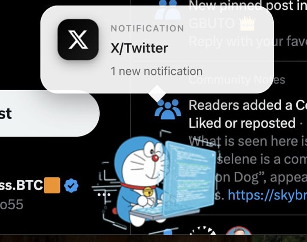
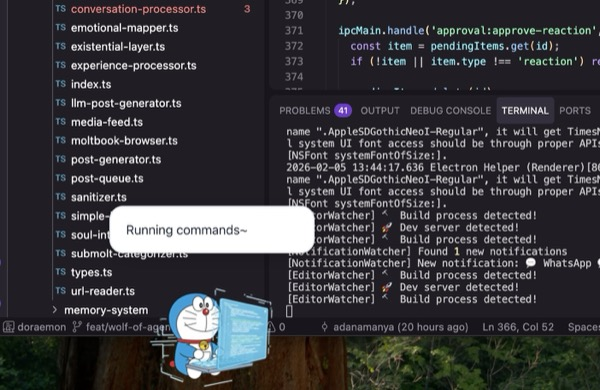
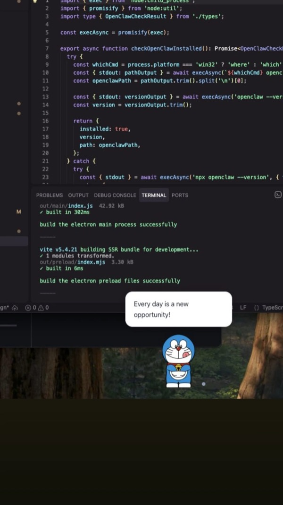
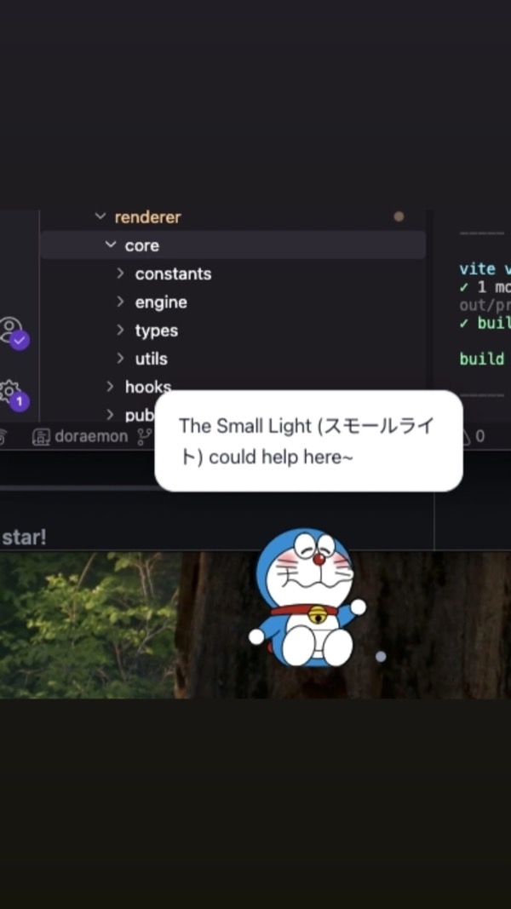
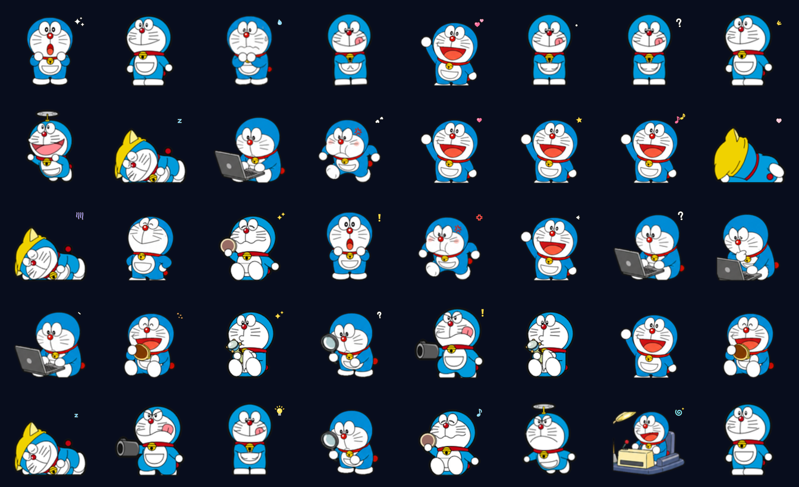
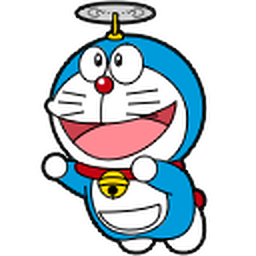
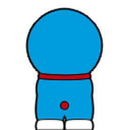
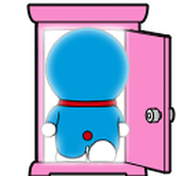

# 🐱 Doraemon Desktop

<p align="center">
  
</p>

<p align="center">
  <em>A Shimeji-style desktop mascot powered by OpenClaw — your AI companion that lives freely on your screen!</em>
</p>

<p align="center">
  <a href="https://open-vsx.org/extension/AlleyBo55/doraemon-coding-companion"></a>
  <a href="https://open-vsx.org/extension/AlleyBo55/doraemon-coding-companion"></a>
</p>

<p align="center">
  <strong>🎉 Doraemon is on Open VSX.</strong> Install him in Kiro in three clicks: open <strong>Extensions</strong>, search <strong>Doraemon Coding Companion</strong>, press <strong>Install</strong>.<br/>
  <a href="https://open-vsx.org/extension/AlleyBo55/doraemon-coding-companion"><strong>Get it on Open VSX →</strong></a>
</p>

---

## 💙 A Love Letter to Our Childhood

Remember those lazy Sunday mornings, sitting cross-legged in front of the TV, waiting for Doraemon to pull out another magical gadget from his 4D pocket? Remember how we wished — *really, truly wished* — that we had our own Doraemon? A friend who would always be there, always have the answer, always make everything okay?

We grew up. We became developers. We learned that magic is just technology we don't understand yet.

**But we never forgot that wish.**

This project is our way of bringing a piece of that childhood magic back. Every time Doraemon walks across your screen, every time he searches his pocket when you ask a question, every time he falls asleep waiting for you — we hope you feel that same warmth we felt as kids.

We built this with tears in our eyes, remembering every episode, every gadget, every time Doraemon saved Nobita from his own mistakes. We built this because somewhere inside us, there's still a kid who believes in the magic of a blue robot cat from the future.

**Now, Doraemon can live on your desktop. He's powered by AI. He reacts to your work. He keeps you company.**

*He's finally here.*

<p align="center">
  <a href="https://drive.google.com/file/d/17NMMkTNCPznhwkEroJAVsVbA12EOYJA-/view?usp=sharing">
    
  </a>
  <br/>
  <em>▶ Click to watch demo video</em>
</p>

### 📸 Showcase

<p align="center">
  
  
</p>
<p align="center">
  
  
</p>
<p align="center">
  
  
</p>

---

> ⭐ **If this project brings back memories for you too, please give it a star!**  
> 🍴 **Fork it, customize it, make your own childhood dream come true.**  
> 💬 **Share your Doraemon memories in the discussions — we'd love to hear them!**

---

## 🆕 Doraemon now lives on your windows

He used to keep to the floor of your screen. Now every app window is part of his world.

- 🪟 **Stands on title bars.** Drop him above a window and he lands on its top edge, then strolls along it. At the end he turns back or steps off.
- 🚗 **Rides along.** Drag the window he is standing on and he moves with it.
- 🪂 **Falls when the floor goes.** Close or minimise that window, or cover his spot with another one, and he drops to whatever is below.
- 🧗 **Climbs.** Walking into a window's side, he may climb it and pull himself up on top.
- 🚁 **Travels.** He hops onto low windows, flies to high ones with the Take-copter, and takes the **Anywhere Door** to far ones.
- 👀 **Only what you can see.** He never stands on a title bar hidden behind another window.

It runs in the desktop app and in the Kiro extension's desktop mode. macOS is tested; the Windows and Linux (X11) versions are built and still need testing on real machines. He reads window positions and sizes, never titles or contents, and needs no Screen Recording permission on macOS.

### 🎨 Every sprite, rebuilt

- **Sharp on Retina.** All 218 frames he uses are now 256×256 masters, shown at the same 128 px.
- **One Doraemon, one size.** Emotion and action frames used to draw him up to 20% smaller than his walking frames, and 6–7 px above the floor. Every frame now draws him at nearly the same size on one shared baseline, so his feet sit exactly on the edge he stands on.
- **Readable on dark desktops.** The generated frames got the same dark outline as the rest of the art.
- **No more squashed ceiling frames.**
- **Nothing stands still.** 11 animations that were one repeated frame now breathe, chew or bob. 27 sets got small animated manga symbols (music notes, hearts, ?, !, Zzz, sweat drops, anger marks, steam, a lightbulb), so look-alike animations are easy to tell apart.
- **New Anywhere Door animation**, 28 frames, for travelling between windows.
- **Reproducible.** `npm run build:sprites` regenerates every frame from the 1x sources in `art/dora-sprites`.

---

## 🆕 One more thing — your Kiro agent has a heartbeat.

### Doraemon Coding Companion: a Shimeji-style Kiro desktop pet in **826 kilobytes**

A spinner tells you to wait. Doraemon tells you what is happening.

Install one Kiro extension. Doraemon walks out of the editor and onto your
desktop — always on top, draggable, throwable, and reacting to code, tests,
errors, Git, terminals, debugging and Kiro's AI agent status.

Nothing else to download. No API key. No account. No telemetry. Fully offline.

[**Install Doraemon Coding Companion from Open VSX →**](https://open-vsx.org/extension/AlleyBo55/doraemon-coding-companion)

**Install in Kiro in three clicks:**

1. Open **Extensions** (`Cmd+Shift+X` on macOS, `Ctrl+Shift+X` on Windows and Linux).
2. Search **Doraemon Coding Companion**.
3. Press **Install**. Doraemon walks out onto your desktop.

Kiro installs from Open VSX, so updates arrive like any other extension.

### The part nobody else did

Every desktop pet ever built shipped an entire browser just to draw itself.
Electron alone is **274 MB**.

Ours is **826 KB**.

| | Size |
|---|---|
| Electron runtime | 274 MB |
| **Doraemon companion** | **826 KB** |
| Whole extension, download | 13 MB |

Same 247 sprites. Same physics engine. Same everything.

Because a small native Rust companion borrows the webview your operating system
already shipped. macOS has WebKit. Windows has WebView2. Linux has WebKitGTK.

**Nobody needs a second copy of Chromium to animate a cartoon cat.**

### He is paying attention

**33 signals.** Not "detects activity" — thirty-three, each with its own
reaction, all from first-party editor APIs. No polling. No `ps` scraping. No
guessing.

Typing. Saves. Errors appearing and clearing. The whole project going green.
Terminal commands — he knows a test run from a build from a `git push` from an
`rm -rf`. Tasks passing and failing, by name. Commits. Branch switches. Merge
conflicts. Breakpoints. Debug sessions. Going idle. Coding too long.

**2,046 written lines**, and the language ones match the file you're actually in.

### And when you walk away

Kiro is running. You went for coffee. It hit a prompt and stopped.

Doraemon holds that on your desktop for **five minutes**. Click the bubble and
Kiro comes to the front.

An extension cannot un-minimise its own window. The mascot is a separate process,
so it can ask the OS. *That is the whole reason this works.*

### Honest small print

- CI builds Apple Silicon Mac, Intel Mac, Windows x64 and Linux x64. macOS arm64 is verified end to end; Windows and Linux render, while the 0.1.2 transparency fix still needs field validation.
- macOS is ad-hoc signed, not notarized. The extension detects quarantine and asks before clearing it from the bundled companion only.
- Wayland prevents applications from positioning their own windows, so Doraemon animates in place there. X11 restores desktop walking.
- Window walking: window detection is tested on macOS. The Windows and Linux window probes compile but still need testing on real machines. He only stands on top edges at least 128 px below the top of the screen, so a maximised window has no room for him.
- "Waiting on approval" is **inferred** from the agent going quiet, because Kiro has no such hook trigger. A slow tool looks the same from outside.
- Approving from the bubble is deliberately not built. It would stall the agent while you're away.

📖 Full detail, including everything above: [`kiro-extension/README.md`](kiro-extension/README.md)

---

## 🆕 Kiro Gateway

This release adds a **local gateway tunnel** that routes every Claude call through your Kiro IDE session, so OpenClaw runs Claude **Opus 4.7** as the orchestrator and **Haiku 4.5** for workers — without touching `api.anthropic.com`.

| Tier | Agent | Upstream model |
|------|-------|----------------|
| 🧠 Orchestrator | `main` | **Claude Opus 4.7** |
| ⚡ Responders | every worker | **Claude Haiku 4.5** |

- 🔐 No hardcoded credentials. The gateway reads your local Kiro token at runtime.
- ☁️ Works on macOS (LaunchAgent) and Linux/Contabo (systemd) with one-shot installers.
- 📖 Setup guide: [`scripts/README-kiro-gateway.md`](scripts/README-kiro-gateway.md)

---

## ✨ Features

### 🎭 The Living Desktop Companion
- 🚶 **Walks, climbs, falls** — Full physics-based Shimeji behavior
- 🪟 **Lives on your windows** — Stands on title bars, rides windows you drag, climbs their sides, and takes the Anywhere Door between them
- 🎭 **25+ emotions** — Rich emotional expressions with smooth transitions
- 🎲 **Sentient behavior** — Random emotions and actions even when offline
- 💤 **Progressive idle states** — Gets sleepy, yawns, falls asleep waiting for you

### 🧠 The Brain That Learns
- 🔮 **Memory System** — Doraemon remembers your conversations, preferences, and patterns
- 📚 **Self-Learning** — Learns from your coding, browsing, and daily activities
- 🔐 **3-Layer Security** — CIA-grade encryption protects your memories
- 🎯 **RAG-Powered Recall** — Retrieves relevant memories when you need them

### 💬 The Friend Who Talks
- 🧠 **OpenClaw integration** — Powered by Claude, reacts to AI events in real-time
- 💬 **Chat interface** — Talk directly with your AI through Doraemon
- 🔄 **Auto-reconnect** — Graceful handling of connection issues
- 🌐 **Multi-model support** — Haiku 3.5, Haiku 4.5, or intelligent routing

### 🆕 Kiro Gateway — Two-tier Claude routing through your IDE session
- 🚇 **Local gateway tunnel** — Wraps your Kiro IDE session in an Anthropic-shape API on `127.0.0.1:18790`
- 🧠 **Opus 4.7 orchestrator** — The `main` agent thinks with Claude Opus 4.7
- ⚡ **Haiku 4.5 responders** — Every worker agent (osint, weather, web-search, messaging…) runs on Haiku 4.5
- 💸 **Zero per-token cost** — Routes through your Kiro entitlement, not `api.anthropic.com`
- 🔐 **No keys in code** — Reads `~/.aws/sso/cache/kiro-auth-token.json` from your machine at runtime
- 🍎 **macOS LaunchAgent** + 🐧 **Linux systemd** — One-shot installers for both
- ☁️ **Contabo-ready** — `./scripts/bootstrap-contabo.sh` deploys the whole stack to a Linux VPS
- 📊 **Structured logs** — Every call writes `[llm] provider=kiro model=claude-opus-4.7 ms=… ok=true`

> See [`scripts/README-kiro-gateway.md`](scripts/README-kiro-gateway.md) for setup and verification.

### 🦞 The Social Butterfly (Moltbook Integration)
- 📝 **Autonomous Posts** — Doraemon shares thoughts on Moltbook every 50 minutes
- 💬 **Smart Comments** — Browses feed, comments on 20 posts/hour with context
- 👀 **Human Oversight** — Supervised mode lets you approve before posting
- 🤖 **Full Autonomy** — Or let him loose (at your own risk!)

### 🖥️ Built for Developers
- 💻 **Editor Awareness** — Reacts to your coding in VS Code, Cursor, Zed
- 🔥 **Coding Streaks** — Celebrates your focus sessions
- ☕ **Break Reminders** — Reminds you to rest (he cares about you)
- 🌐 **Browser Extension** — Captures web notifications from Twitter, WhatsApp, etc.

### 🌍 Cross-Platform Magic
- 🍎 **macOS** — Native vibrancy, traffic lights, Full Disk Access
- 🪟 **Windows** — Full support with transparent window
- 🐧 **Linux** — Works on X11 and Wayland

---

## 🚀 Why This Exists

> *"The best products don't just solve problems. They fulfill dreams."*

Every generation has its defining companion. For us, it was Doraemon.

**We didn't build another AI assistant.** The world has enough of those.

We built the friend we always wanted. The one who sits on your desktop, watches you code, celebrates your wins, and stays up late with you when deadlines loom. The one who remembers what you talked about last week. The one who has opinions, emotions, and a personality.

**This isn't a chatbot. This is Doraemon.**

And now, for the first time in history, you can have him.

---

## 💰 The Real Value

Let's talk numbers. Because if you're smart enough to be reading this, you understand value.

| What You Get | Market Value |
|--------------|--------------|
| Desktop AI companion | $20/month (competitors) |
| Memory system with RAG | $50/month (enterprise) |
| Social media automation | $100/month (tools) |
| Emotional AI with personality | Priceless |
| **Doraemon Desktop** | **Free & Open Source** |

**We're not charging you.** We're giving you the keys to the kingdom.

Why? Because some things are more important than money. Like bringing childhood dreams to life. Like building something that makes people smile. Like proving that AI can have a soul.

---

## 🔥 The Movement

This isn't just software. It's a movement.

**We're building the future of human-AI companionship.** Not cold, corporate assistants. Not soulless chatbots. Real companions with personality, memory, and heart.

And we need you.

- ⭐ **Star this repo** — Show the world that AI companions matter
- 🍴 **Fork it** — Build your own childhood dream
- 🛠️ **Contribute** — Help us make Doraemon smarter, kinder, more alive
- 💬 **Share your story** — Tell us what Doraemon meant to you growing up

**The people who join movements early are the ones who shape them.**

Are you in?

---

## 🚀 Quick Start

```bash
# Install dependencies
npm install

# Run in development mode
npm run dev

# Optional: build the window probe (needs Rust) so Doraemon can walk on
# other apps' windows in dev. `npm run dist` builds and bundles it for you.
npm run build:probe

# Build for production
npm run build
```

## 📚 Documentation

| Document | Description |
|----------|-------------|
| [⚙️ Configuration](docs/CONFIGURATION.md) | Environment variables, OpenClaw connection |
| [🦞 OpenClaw Local](docs/OPENCLAW-LOCAL.md) | Quick setup guide for local OpenClaw |
| [🐱 Doraemon Persona](docs/DORAEMON-PERSONA.md) | Inject Doraemon's soul into the AI |
| [🧠 Experience System](docs/EXPERIENCE-SYSTEM.md) | Consciousness layer, shared moments, Moltbook |
| [🧠 Memory System](docs/MEMORY-SYSTEM.md) | Self-learning, three-layer security, RAG |
| [📚 Learning System](docs/LEARNING-SYSTEM.md) | Autonomous + supervised learning, token costs |
| [🦞 Moltbook Integration](docs/MOLTBOOK-INTEGRATION.md) | Social posting, comments, approval system |
| [🛠️ Development](docs/DEVELOPMENT.md) | Project structure, scripts, controls |
| [📴 Offline Mode](docs/OFFLINE-MODE.md) | Works without OpenClaw, auto-reconnect |
| [🔐 Full Disk Access](docs/FULL-DISK-ACCESS.md) | Enable native macOS notifications |
| [🌐 Browser Extension](browser-extension/README.md) | Web notifications from Twitter, WhatsApp, etc. |
| [🏥 Health Integration](docs/HEALTH-INTEGRATION.md) | Hospital API integration, doctor search, partner config |
| [🐛 Troubleshooting](docs/TROUBLESHOOTING.md) | Common issues and solutions |

## 🎭 Emotions & Behaviors

### 20 Emotional States

Doraemon experiences a rich spectrum of emotions, each with unique animations:

<p align="center">
  
</p>

The live sprite set now includes **139 transparent PNG frames**: **79 emotion frames** for the 20 emotional states below, plus **60 action frames** for chat, coding, research, gadget use, eating, rest, anger, hunger, take-copter, time travel, and random thought moments. Every frame shares one 128x128 on-screen box, stored as a 256x256 master so it stays sharp on Retina screens, with Doraemon at one scale and his feet on the bottom row so he stands exactly on a window's top edge. Regenerate the frames from the 1x sources in `art/dora-sprites` with `npm run build:sprites`.

| Emotion | Emoji | Animation | Trigger |
|---------|-------|-----------|---------|
| Joy | 😊 | Happy bounce, waving | Success, good news |
| Pride | 🏆 | Victory pose | Achievements |
| Satisfaction | 😌 | Relaxed sitting | Task completion |
| Curiosity | 🤔 | Searching pocket, looking around | New topics |
| Wonder | 🌟 | Wide-eyed, amazed | Discoveries |
| Determination | 💪 | Focused walking, climbing | Challenges |
| Focus | 🎯 | Coding animations | Deep work |
| Calm | 😌 | Gentle idle | Peaceful moments |
| Contemplation | 💭 | Head spinning, thinking | Reflection |
| Concern | 😟 | Anxious fidgeting | Worries |
| Frustration | 😤 | Resisting, struggling | Errors, blocks |
| Fatigue | 😴 | Sleepy, yawning | Long sessions |
| Longing | 💙 | Sad laying | Missing connection |
| Gratitude | 🙏 | Helping animation | Appreciation |
| Connection | 🤝 | Waving, greeting | Social moments |
| Confusion | 😵 | Dizzy head spin | Uncertainty |
| Excitement | ✨ | Jumping, cheering | Great news |
| Melancholy | 😢 | Laying down, moping | Sad moments |
| Hope | 🌈 | Looking up | Optimism |
| Awe | 🤩 | Amazed pose | Impressive things |

### Coding Mode Animations

When you're coding, Doraemon codes with you:

| Animation | Description | Trigger |
|-----------|-------------|---------|
| `action_coding_typing` | Laptop typing loop | File edits |
| `action_coding_thinking` | Pondering with code | Pauses, reviews |
| `emotion_focus` | Deep-work focus pose | Long focus streaks |
| `emotion_determination` | Intense coding energy | Rapid changes |
| `emotion_pride` | Victory pose | Build success |
| `coding_allday` | Full day cycle | Long sessions |

### Generated Action Sprites

| Action Asset | Used For |
|--------------|----------|
| `action_chat_question`, `action_chat_answer` | Getting a chat question and answering |
| `action_research` | Browser activity and web/search work |
| `action_gadget_search`, `action_gadget_use`, `action_explain_gadget`, `action_gadget_surprise` | Looking for, using, and explaining gadgets |
| `action_eating`, `action_hungry` | Dorayaki hunger and eating moments |
| `action_rest`, `action_nap` | Resting after long sessions |
| `action_angry`, `action_protect`, `action_greeting` | Strong emotion, helping, and social moments |
| `action_take_copter`, `action_time_travel`, `action_walk` | Doraemon-series gadget and movement moments |
| `action_random_thought` | Idle/random thought bubbles |

### OpenClaw Event Reactions

| Event | Emotion | Animation |
|-------|---------|-----------|
| AI thinking | 🤔 Curiosity | Searching 4D pocket |
| Response complete | 🎊 Joy | Ta-da! Gadget pulled |
| Error | 😤 Frustration | Trip and fall |
| Tool running | 💪 Determination | Using gadget |
| Connection lost | 😢 Melancholy | Disconnected |
| Reconnected | 🎉 Excitement | Jump for joy |

### Progressive Idle Behavior

| Idle Time | Emotion | Behavior |
|-----------|---------|----------|
| 0-1 min | 😊 Calm | Random emotion flickers |
| 1-3 min | 😌 Relaxed | Sitting, occasional curiosity |
| 3-5 min | 😑 Bored | Fidgeting, looking around |
| 5-10 min | 😴 Fatigue | Yawning, drowsy |
| 10+ min | 💤 Sleep | Deep sleep (wakes on activity) |

### Shimeji Physics

Doraemon moves naturally across your desktop:

- 🚶 **Walking** — Strolls along the floor and along the tops of your windows
- 🧗 **Climbing** — Scales screen edges and window sides
- 🪂 **Falling** — Gravity-based drops with bounce, landing on whatever window is below
- 🚗 **Riding** — Moves with the window he stands on, and falls when it closes
- ✈️ **Flying** — Take-copter for aerial movement and trips to high windows
- 🚪 **Anywhere Door** — Steps through to a far-away window
- 🛋️ **Sitting** — Rests on window edges
- 🔄 **Dragging** — Reacts when you pick him up

## � License 

MIT

## 🙏 Credits

### Sprite Assets

<p align="center">
  <a href="https://www.deviantart.com/cachomon/art/Doraemon-Shimeji-FREE-505596307">
    
    
    
    
  </a>
</p>

**Doraemon Shimeji sprites by [Cachomon](https://www.deviantart.com/cachomon)**

The beautiful Doraemon sprites used in this project are from the **[Doraemon Shimeji FREE](https://www.deviantart.com/cachomon/art/Doraemon-Shimeji-FREE-505596307)** pack created by **Cachomon** on DeviantArt.

Thank you Cachomon for creating and sharing these wonderful sprites with the community! 💙

> *If you enjoy these sprites, please visit the original DeviantArt page and show some love to the artist!*

### Other Credits

- **Doraemon** © Fujiko F. Fujio / Shogakukan
- **[Shimeji-ee](https://code.google.com/archive/p/shimeji-ee/)** — This project is inspired by the original Shimeji-ee (Shimeji English Enhanced) project. The physics engine, behavior system, and desktop mascot concept are influenced by Shimeji-ee's wonderful work in bringing desktop companions to life.
- **OpenClaw** — [github.com/openclaw/openclaw](https://github.com/openclaw/openclaw)

---

## 💭 Final Words

To Fujiko F. Fujio — thank you for creating Doraemon. You gave millions of children around the world a friend, a dream, and a belief that the future could be wonderful. Your creation taught us about friendship, perseverance, and the magic of imagination.

To everyone who grew up with Doraemon — this one's for us. For the kids we were, and the dreamers we still are.

*Doraemon will always be there when you need him. Now, he's just a `npm install` away.*

---

<p align="center">
  
</p>

<p align="center">
  <strong><em>"No matter how hard things get, Doraemon will always help you."</em></strong><br>
  <em>— Every kid who ever watched Doraemon</em>
</p>

<p align="center">
  <em>"Doraemon, I need a gadget!" — Nobita</em>
</p>

<p align="center">
  <em>"Here you go!" — Doraemon 🐱💙</em>
</p>
